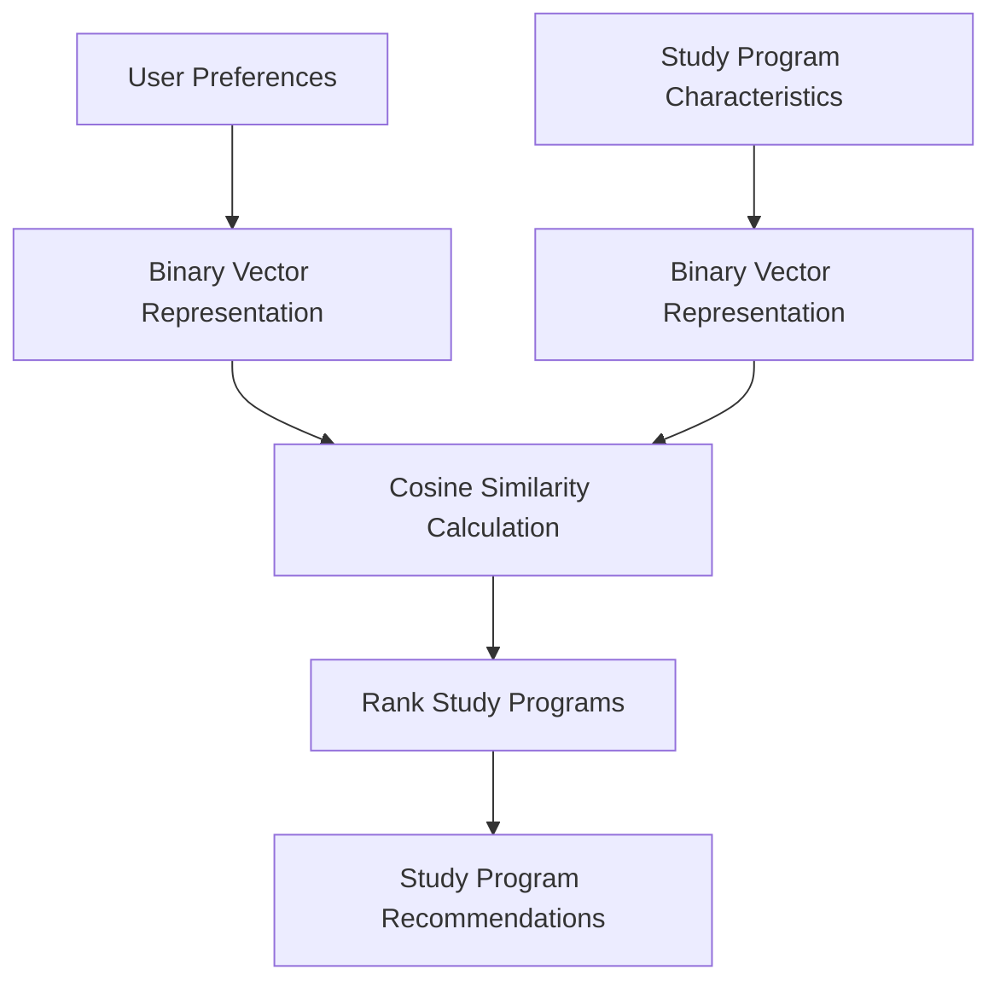

# MajorneyAI — Study Program Recommendation System

A web-based study program recommendation system developed using Content-Based Filtering with Binary Vector Representation and Cosine Similarity to help prospective students identify relevant academic study programs based on their preferences.

## Overview

MajorneyAI was developed as an undergraduate thesis project in Informatics Engineering at Tiga Serangkai University.

The application combines web development and recommendation algorithms to support prospective students in selecting academic study programs that align with their preferences.

## Project Objectives

- Support prospective students in selecting relevant study programs.
- Implement a content-based recommendation approach.
- Represent user preferences and study program characteristics using binary vectors.
- Calculate similarity scores using Cosine Similarity.
- Present relevant study program recommendations through a web application.

## Recommendation Methodology

### Content-Based Filtering

Content-Based Filtering generates recommendations by comparing user preferences with the characteristics of available study programs.

### Binary Vector Representation

User preferences and study program characteristics are represented as binary vectors:

- 1 represents the presence of a characteristic.
- 0 represents the absence of a characteristic.

This representation enables mathematical comparison between user preferences and study program profiles.

### Cosine Similarity

Cosine Similarity measures the similarity between two vectors using the following formula:

$$
\text{Similarity}(A,B) =
\frac{A \cdot B}{\|A\|\|B\|}
$$

Where:

- A represents the user preference vector.
- B represents the study program characteristic vector.
- A · B represents the dot product of both vectors.

A higher similarity score indicates a closer match between user preferences and study program characteristics.

### Recommendation Workflow



## Tech Stack

| Technology | Purpose |
| --- | --- |
| PHP | Server-side application development |
| Laravel | Web application framework |
| Blade | Server-side template engine |
| Tailwind CSS | User interface styling |
| Vite | Frontend asset compilation |
| Composer | PHP dependency management |
| npm | Frontend dependency management |

## Project Structure

```text
majorneyai/
├── app/
├── bootstrap/
├── config/
├── database/
├── public/
├── resources/
├── routes/
├── storage/
├── tests/
├── .env.example
├── artisan
├── composer.json
├── package.json
├── tailwind.config.js
├── vite.config.js
└── README.md
```

## Getting Started

### Prerequisites

- PHP
- Composer
- Node.js
- npm
- Compatible database server
- Git

### Installation

Clone the repository:

```bash
git clone https://github.com/suryaaddii/majorneyai.git
cd majorneyai
```

Install PHP dependencies:

```bash
composer install
```

Install frontend dependencies:

```bash
npm ci
```

Create the environment configuration:

```bash
cp .env.example .env
```

Generate the application key:

```bash
php artisan key:generate
```

Configure the database connection in the `.env` file.

Run database migrations:

```bash
php artisan migrate
```

Start the Laravel development server:

```bash
php artisan serve
```

In a separate terminal, start the frontend development server:

```bash
npm run dev
```

Open http://127.0.0.1:8000 in your browser.

Additional study program data may be required to generate recommendations.

## Production Build

```bash
npm run build
```

## Academic Background

| Information | Details |
| --- | --- |
| Project Type | Undergraduate Thesis |
| University | Tiga Serangkai University |
| Field of Study | Informatics Engineering |
| Year | 2025 |
| Research Area | Recommendation Systems |
| Method | Content-Based Filtering |
| Representation | Binary Vector Representation |
| Similarity Metric | Cosine Similarity |

## Author

**Surya Adi**

Fullstack Software Developer | Backend Development | IoT & System Integration

- Portfolio: https://suryaaddii.vercel.app
- LinkedIn: https://linkedin.com/in/surya-adi-sn
- GitHub: https://github.com/suryaaddii
- Email: surya.datago@gmail.com
